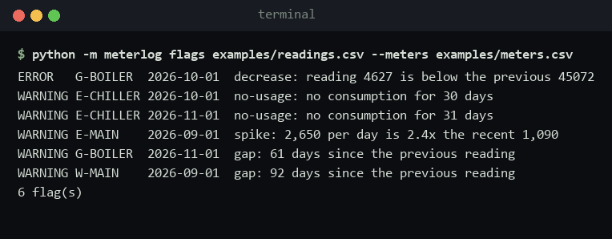

# meter-reading-logger

Utility meters get read once a month, written on a sheet, and typed into a spreadsheet. A dropped digit, a meter that rolled over, a month that was skipped, or a pump that quietly ran all weekend all look like normal numbers until the bill arrives. This repo turns a plain CSV of readings into usage per interval and flags the ones that deserve a second look.



## What it is for

Facility managers, energy coordinators and building operators who read electric, water and gas meters by hand. The tool computes consumption between readings, normalizes it to a rate per day (so a 31 day month and a 28 day month compare fairly), and flags: a reading that went down, a sudden spike against the recent rate, a long stretch with no consumption, a long gap between readings, and a duplicate date. Meters that roll over (a dial that goes from 99999 back to 0) are handled when you give the rollover limit.

## Install

```
git clone https://github.com/yassine2med/meter-reading-logger
cd meter-reading-logger && pip install -r requirements.txt
```

No third-party packages are needed. Python 3.10 or newer.

## How to use

| I want to | Command |
|---|---|
| List anomalies | `PYTHONPATH=src python -m meterlog flags examples/readings.csv --meters examples/meters.csv` |
| See usage per interval for one meter | `PYTHONPATH=src python -m meterlog usage examples/readings.csv --meters examples/meters.csv --meter W-MAIN` |
| Add a new reading (checked first) | `PYTHONPATH=src python -m meterlog add my_readings.csv E-MAIN 2026-12-01 785000` |
| Make flags less or more sensitive | `--spike 3`, `--zero-days 45`, `--gap-days 60` |

`readings.csv` columns: `meter_id, date, reading`. `meters.csv` (optional) columns: `meter_id, type, unit, location, rollover_at`.

Exit codes: 0 on success, 1 when `flags` finds anything, 2 on a missing file, bad value, or a reading `add` refuses.

Example:

```
PYTHONPATH=src python -m meterlog flags examples/readings.csv --meters examples/meters.csv
```

Output:

```
ERROR   G-BOILER  2026-10-01  decrease: reading 4627 is below the previous 45072
WARNING E-CHILLER 2026-10-01  no-usage: no consumption for 30 days
WARNING E-CHILLER 2026-11-01  no-usage: no consumption for 31 days
WARNING E-MAIN    2026-09-01  spike: 2,650 per day is 2.4x the recent 1,090
WARNING G-BOILER  2026-11-01  gap: 61 days since the previous reading
WARNING W-MAIN    2026-09-01  gap: 92 days since the previous reading
6 flag(s)
```

Usage for the water meter (the first interval crosses the 100000 rollover):

```
meter      from        to           days     usage   per day  unit
W-MAIN     2026-04-01  2026-05-01     30    12,600     420.0  gal x100  rollover
W-MAIN     2026-05-01  2026-06-01     31    13,950     450.0  gal x100
W-MAIN     2026-06-01  2026-09-01     92    39,560     430.0  gal x100
W-MAIN     2026-09-01  2026-10-01     30    13,200     440.0  gal x100
W-MAIN     2026-10-01  2026-11-01     31    12,865     415.0  gal x100
```

Run the tests with `python -m pytest -q`.

## How it works

1. Readings are grouped by meter and sorted by date. Usage is this reading minus the last good reading.
2. A lower reading is a rollover when the meter has a `rollover_at` limit, the last reading was above half of it and the new one is below half. Otherwise it is flagged as a decrease and skipped, so the next interval spans both periods.
3. Spike: the rate per day is more than `--spike` times the median of the previous three rates (needs at least three).
4. No usage: zero consumption over at least `--zero-days` days. Gap: more than `--gap-days` between two readings.
5. `add` refuses a date that is not after the last reading, and a reading below the last one.

## Limits

- Flags are screening rules. A heating meter in autumn or a cooling meter in spring can trip the spike rule honestly; the thresholds are yours to tune.
- One register per meter. No multipliers, tariffs or cost.
- Dates are whole days (`YYYY-MM-DD`).
- Seasonal baselines are not modeled.

## License

MIT. Yassine Emhamed, 2026.
